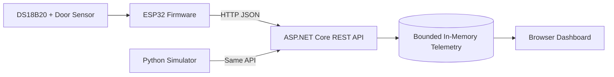

# Enterprise IoT Monitor — ESP32 + ASP.NET Core

**An integrated embedded-systems and enterprise-software portfolio project by Justice Zhou.**

[](https://github.com/JUZHOU88/Enterprise-IoT-Monitor/actions/workflows/ci.yml)

**Embedded C++ · ESP32 · DS18B20 · Wi-Fi · HTTP/JSON · ASP.NET Core (.NET 10) · Thread-safe C# services · REST API · Web dashboard · Automated tests**

This project demonstrates a microcontroller delivering telemetry to an ASP.NET Core service that validates, stores and presents it. A Python device simulator exercises the same contract so reviewers can run the backend and dashboard without owning an ESP32.

> **Scope:** Original **local-development demonstration**, not a deployed industrial or clinical system. Physical ESP32 integration has not yet been verified. Temperature thresholds (18–28 °C) are **illustrative**, not medical standards.

## Architecture



## Quick start — no hardware required

Install the [.NET 10 SDK](https://dotnet.microsoft.com/download/dotnet/10.0) and Python 3.

**Terminal 1** — from the repository root:

```bash
dotnet run --project backend/IntegratedMonitor.Api -- --urls http://localhost:5070 --environment Development
```

**Terminal 2**:

```bash
python3 simulator/simulate.py --count 25 --interval 1
```

Open **http://localhost:5070** to view devices and readings.

The simulator's default key, `local-demo-key`, is for **Development only**. The API will require the `MONITOR_DEVICE_KEY` environment variable outside that environment. Do not expose the demo API on a public network.

## ESP32 firmware

Open the `firmware` directory in PlatformIO. Copy `firmware/include/secrets.example.h` to `firmware/include/secrets.h` and supply your local Wi-Fi credentials, backend LAN address and the same API device key.

For an ESP32 DevKit demonstration:

| Hardware | Example connection |
| --- | --- |
| DS18B20 data | GPIO 4 (4.7 kΩ pull-up to 3.3 V) |
| Door switch | GPIO 27 and GND (`INPUT_PULLUP`) |
| Status LED | GPIO 2 (low-current indicator, if available) |

**Use only safe low-voltage lab circuits.** Never connect a relay coil or mains-powered device directly to a GPIO. Verify your ESP32 board pinout.

The ESP32 and backend machine must be reachable on the same trusted LAN; do not port-forward this demonstration.

## Test commands

```bash
dotnet run --project backend/IntegratedMonitor.Tests

g++ -std=c++17 -Wall -Wextra -Werror -Ifirmware/include firmware/src/MonitorLogic.cpp firmware/test/core_tests.cpp -o core-tests
./core-tests
```

The [CI workflow](.github/workflows/ci.yml) builds the .NET API, runs eight C# domain test scenarios, builds/tests the portable embedded C++ logic and validates Python simulator syntax. **Check the Actions tab before treating tests as successful.**

## Functionality

- ESP32 firmware: temperature sampling, door status, local alert indicator and HTTP JSON telemetry.
- Backend: input validation, development device-key authentication and idempotent ingestion.
- A concurrency-safe, bounded in-memory store for readings and device summaries.
- Browser dashboard that polls the API for current device state and recent readings.
- Python simulator that sends the same API payload without real hardware.
- Standalone C# and C++ test runners.

## Important limits

- Readings are lost when the backend stops. Event deduplication is not durable and expires when old history is evicted.
- Failed device uploads are not queued for retry.
- HTTP transfers are synchronous and can briefly delay firmware execution.
- The API permits unauthenticated reads and uses a development-only shared key. It is **not production-secure**.
- Real use requires durable storage, HTTPS, authenticated dashboard users, proper device provisioning, electrical validation and appropriate sensor calibration.
- The hardware firmware has not yet been built and tested on a physical ESP32 in this public demonstration.

See [architecture and protocol notes](docs/ARCHITECTURE.md).

## Author

**Justice Zhou** — Software Engineer · Embedded Systems · Backend & Enterprise Applications

[GitHub profile](https://github.com/JUZHOU88) · [C# billing engine](https://github.com/JUZHOU88/Idempotent-Billing-Engine-CSharp) · [ESP32 Environmental Monitor](https://github.com/JUZHOU88/ESP32-Environmental-Monitor)

MIT licensed. Original portfolio demonstration, not Net IT Solutions commercial source.
