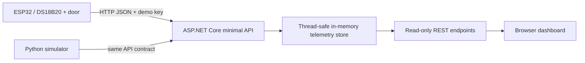

# Architecture and boundaries



## Enterprise and embedded integration

The ESP32 collects device state and sends JSON to the server. The ASP.NET Core server validates a device identifier and event identifier, validates readings, computes demo alerts and retains bounded history. The browser dashboard polls the REST API and displays recent readings.

A Python simulator emits the **same JSON payload as the ESP32** and allows reviewers to exercise the application without hardware. The same server handles both.

## Protocol

`POST /api/telemetry` with `Content-Type: application/json` and `X-Device-Key: <configured-key>`:

```json
{"deviceId":"esp32-demo","eventId":"a1b2c3-1","temperatureC":22.5,"doorOpen":false,"sensorOk":true,"uptimeMs":10000}
```

The server responds with **201 Created** for a new event and **200 OK** for an identical retry. Conflicting reuse of an event ID returns **400**.

`GET /health`, `GET /api/devices`, and `GET /api/devices/{deviceId}/readings?limit=30` are read-only endpoints for **local demonstration**.

## Engineering choices and limitations

- The server assigns its own timestamp on ingestion; device uptime is not a wall-clock timestamp.
- Identifiers are unique within the bounded retained history, not durably persisted.
- Storage is **in-memory**, with no database or message broker.
- Shared-key authentication is for local demonstration only. Read endpoints are unauthenticated.
- Production systems require HTTPS, identity management, authorization, persistent storage and database uniqueness.
- Firmware uses non-blocking temperature conversion, but **HTTP POST is synchronous** and may temporarily delay the main loop.
- Unsent events are not buffered or reliably retried.
- The dashboard uses DOM `textContent` for device-generated strings, rather than interpreting them as HTML.
